<p align="center"><a href="https://beatapi.io/qwen4-videos?utm_source=github&amp;utm_medium=gallery&amp;utm_campaign=awesome-qwen4-videos">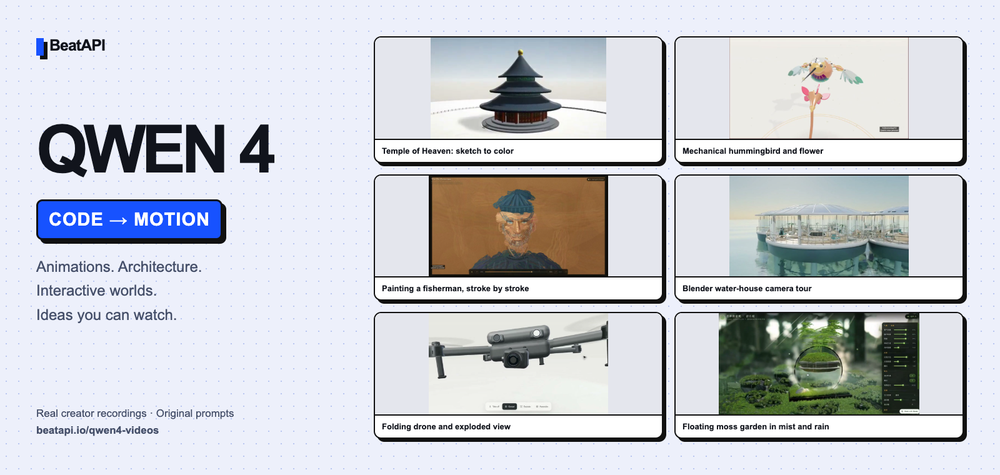</a></p>

# Awesome Qwen 4 Videos

Animations, architecture, 3D scenes and games made through creative coding with Qwen 4. Explore original creator recordings, workflows and published prompts. Every cover opens the corresponding case on BeatAPI.

> Website launch review is in progress. On-site playback links will become available after approval.

**[Browse the video gallery →](https://beatapi.io/qwen4-videos?utm_source=github&utm_medium=gallery&utm_campaign=awesome-qwen4-videos)** · [中文](README.zh-CN.md) · [Contribute a case](CONTRIBUTING.md)

**21 cases · 22 videos · 3 published prompts**

## Start with six

<table>
<tr>
<td width="50%" valign="top"><a href="https://beatapi.io/prompts/qwen4/temple-of-heaven-131506?utm_source=github&amp;utm_medium=gallery&amp;utm_campaign=awesome-qwen4-videos">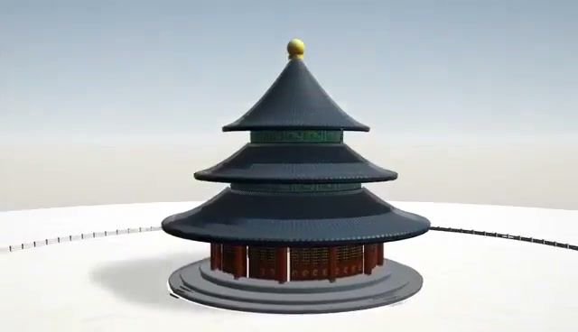</a><br/><a href="https://beatapi.io/prompts/qwen4/temple-of-heaven-131506?utm_source=github&amp;utm_medium=gallery&amp;utm_campaign=awesome-qwen4-videos"><strong>Temple of Heaven: sketch to color</strong></a><br/><sub>Qwen4-Max-Preview · 45s</sub><br/><a href="https://beatapi.io/prompts/qwen4/temple-of-heaven-131506?utm_source=github&amp;utm_medium=gallery&amp;utm_campaign=awesome-qwen4-videos">▶ Watch video</a> · <a href="cases/temple-of-heaven-131506.md">Case notes</a><br/><sub>By <a href="https://x.com/NFT_Chen/status/2120777011065131506">@NFT_Chen</a></sub></td>
<td width="50%" valign="top"><a href="https://beatapi.io/prompts/qwen4/mechanical-hummingbird-069800?utm_source=github&amp;utm_medium=gallery&amp;utm_campaign=awesome-qwen4-videos">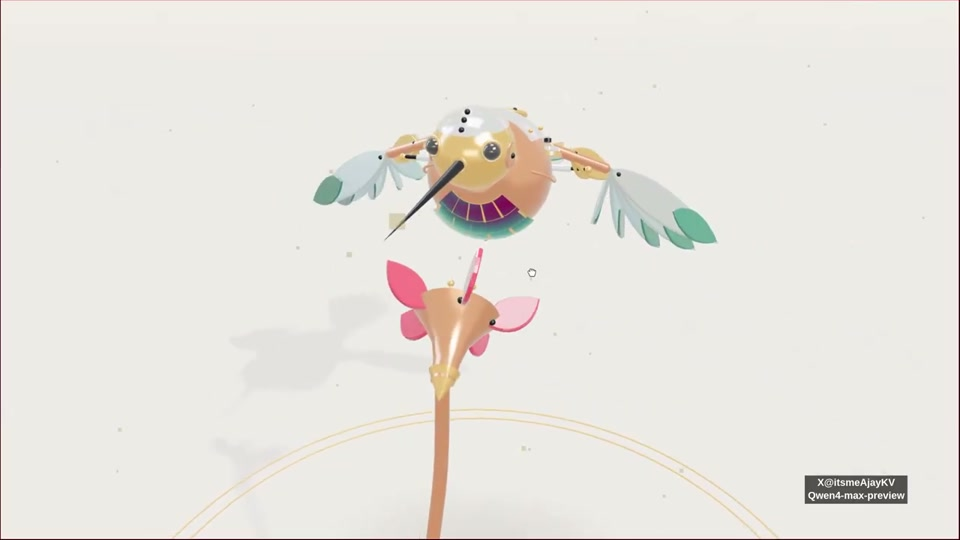</a><br/><a href="https://beatapi.io/prompts/qwen4/mechanical-hummingbird-069800?utm_source=github&amp;utm_medium=gallery&amp;utm_campaign=awesome-qwen4-videos"><strong>Mechanical hummingbird and flower</strong></a><br/><sub>Qwen4-Max-Preview · 67s</sub><br/><a href="https://beatapi.io/prompts/qwen4/mechanical-hummingbird-069800?utm_source=github&amp;utm_medium=gallery&amp;utm_campaign=awesome-qwen4-videos">▶ Watch video</a> · <a href="cases/mechanical-hummingbird-069800.md">Case notes</a><br/><sub>By <a href="https://x.com/ItsmeAjayKV/status/2120676196921069800">@ItsmeAjayKV</a></sub></td>
</tr>
<tr>
<td width="50%" valign="top"><a href="https://beatapi.io/prompts/qwen4/fisherman-oil-portrait-932340?utm_source=github&amp;utm_medium=gallery&amp;utm_campaign=awesome-qwen4-videos">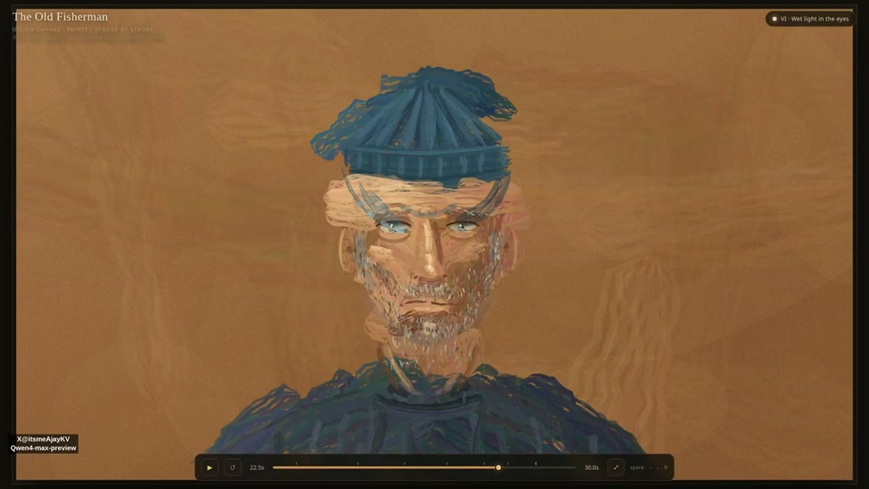</a><br/><a href="https://beatapi.io/prompts/qwen4/fisherman-oil-portrait-932340?utm_source=github&amp;utm_medium=gallery&amp;utm_campaign=awesome-qwen4-videos"><strong>Painting a fisherman, stroke by stroke</strong></a><br/><sub>Qwen4-Max-Preview · 30s</sub><br/><a href="https://beatapi.io/prompts/qwen4/fisherman-oil-portrait-932340?utm_source=github&amp;utm_medium=gallery&amp;utm_campaign=awesome-qwen4-videos">▶ Watch video</a> · <a href="cases/fisherman-oil-portrait-932340.md">Prompt</a><br/><sub>By <a href="https://x.com/ItsmeAjayKV/status/2122038770421932340">@ItsmeAjayKV</a></sub></td>
<td width="50%" valign="top"><a href="https://beatapi.io/prompts/qwen4/floating-water-house-021434?utm_source=github&amp;utm_medium=gallery&amp;utm_campaign=awesome-qwen4-videos">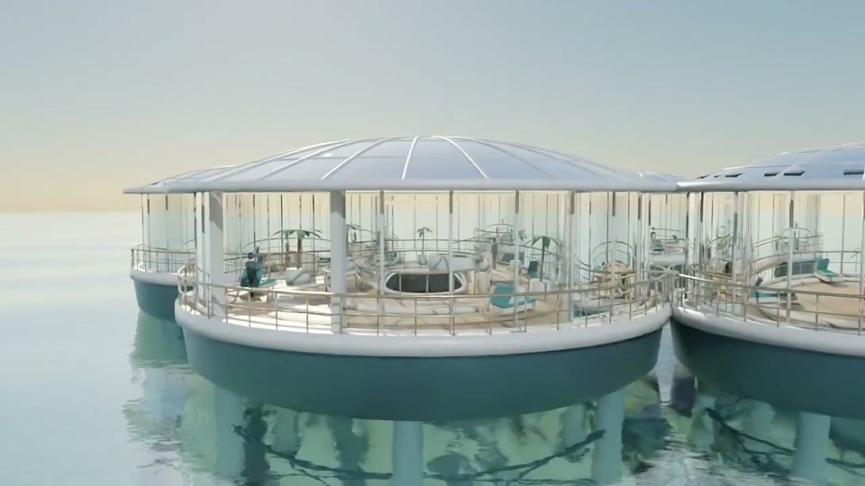</a><br/><a href="https://beatapi.io/prompts/qwen4/floating-water-house-021434?utm_source=github&amp;utm_medium=gallery&amp;utm_campaign=awesome-qwen4-videos"><strong>Blender water-house camera tour</strong></a><br/><sub>Qwen4-Max · 40s</sub><br/><a href="https://beatapi.io/prompts/qwen4/floating-water-house-021434?utm_source=github&amp;utm_medium=gallery&amp;utm_campaign=awesome-qwen4-videos">▶ Watch video</a> · <a href="cases/floating-water-house-021434.md">Case notes</a><br/><sub>By <a href="https://x.com/NFT_Chen/status/2122265524877021434">@NFT_Chen</a></sub></td>
</tr>
<tr>
<td width="50%" valign="top"><a href="https://beatapi.io/prompts/qwen4/folding-drone-251469?utm_source=github&amp;utm_medium=gallery&amp;utm_campaign=awesome-qwen4-videos">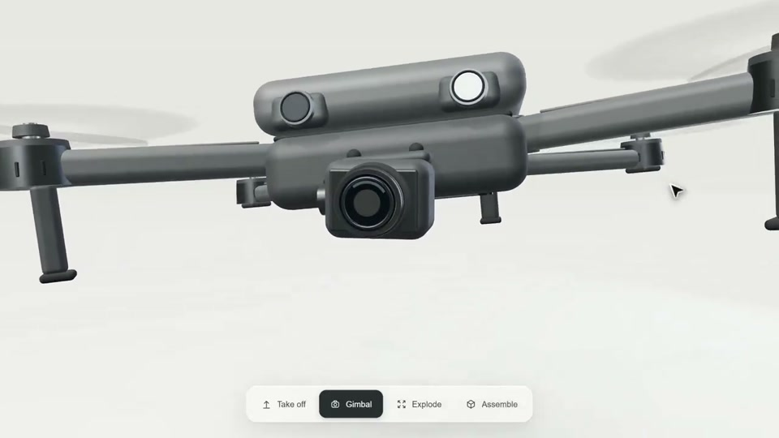</a><br/><a href="https://beatapi.io/prompts/qwen4/folding-drone-251469?utm_source=github&amp;utm_medium=gallery&amp;utm_campaign=awesome-qwen4-videos"><strong>Folding drone and exploded view</strong></a><br/><sub>Qwen4-Max-Preview · 20s</sub><br/><a href="https://beatapi.io/prompts/qwen4/folding-drone-251469?utm_source=github&amp;utm_medium=gallery&amp;utm_campaign=awesome-qwen4-videos">▶ Watch video</a> · <a href="cases/folding-drone-251469.md">Case notes</a><br/><sub>By <a href="https://x.com/elvar_official/status/2120537937406251469">@elvar_official</a></sub></td>
<td width="50%" valign="top"><a href="https://beatapi.io/prompts/qwen4/floating-moss-garden-563391?utm_source=github&amp;utm_medium=gallery&amp;utm_campaign=awesome-qwen4-videos">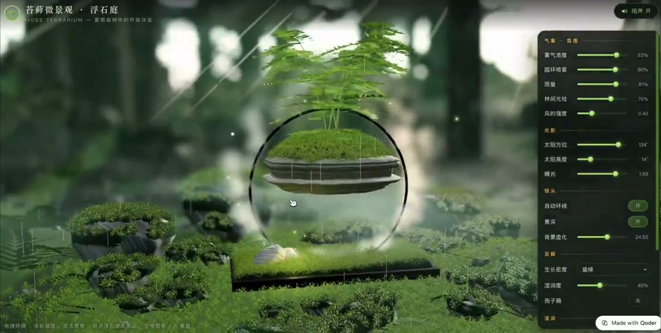</a><br/><a href="https://beatapi.io/prompts/qwen4/floating-moss-garden-563391?utm_source=github&amp;utm_medium=gallery&amp;utm_campaign=awesome-qwen4-videos"><strong>Floating moss garden in mist and rain</strong></a><br/><sub>Qwen4-Max · 37s</sub><br/><a href="https://beatapi.io/prompts/qwen4/floating-moss-garden-563391?utm_source=github&amp;utm_medium=gallery&amp;utm_campaign=awesome-qwen4-videos">▶ Watch video</a> · <a href="cases/floating-moss-garden-563391.md">Case notes</a><br/><sub>By <a href="https://x.com/tanglele0318/status/2122264972889563391">@tanglele0318</a></sub></td>
</tr>
</table>

**[Watch every case on our site →](https://beatapi.io/qwen4-videos?utm_source=github&utm_medium=gallery&utm_campaign=awesome-qwen4-videos)**

## Browse by use

[Architecture & building](#architecture) (4) · [Animation & explainers](#animation) (10) · [3D worlds & games](#worlds) (6) · [Workflow comparisons](#workflows) (1)

<a id="architecture"></a>

## Architecture & building

<table>
<tr>
<td width="33%" valign="top"><a href="https://beatapi.io/prompts/qwen4/temple-of-heaven-131506?utm_source=github&amp;utm_medium=gallery&amp;utm_campaign=awesome-qwen4-videos"></a><br/><a href="https://beatapi.io/prompts/qwen4/temple-of-heaven-131506?utm_source=github&amp;utm_medium=gallery&amp;utm_campaign=awesome-qwen4-videos"><strong>Temple of Heaven: sketch to color</strong></a><br/><sub>Qwen4-Max-Preview · 45s</sub><br/><a href="https://beatapi.io/prompts/qwen4/temple-of-heaven-131506?utm_source=github&amp;utm_medium=gallery&amp;utm_campaign=awesome-qwen4-videos">▶ Watch video</a> · <a href="cases/temple-of-heaven-131506.md">Case notes</a><br/><sub>By <a href="https://x.com/NFT_Chen/status/2120777011065131506">@NFT_Chen</a></sub></td>
<td width="33%" valign="top"><a href="https://beatapi.io/prompts/qwen4/floating-water-house-021434?utm_source=github&amp;utm_medium=gallery&amp;utm_campaign=awesome-qwen4-videos"></a><br/><a href="https://beatapi.io/prompts/qwen4/floating-water-house-021434?utm_source=github&amp;utm_medium=gallery&amp;utm_campaign=awesome-qwen4-videos"><strong>Blender water-house camera tour</strong></a><br/><sub>Qwen4-Max · 40s</sub><br/><a href="https://beatapi.io/prompts/qwen4/floating-water-house-021434?utm_source=github&amp;utm_medium=gallery&amp;utm_campaign=awesome-qwen4-videos">▶ Watch video</a> · <a href="cases/floating-water-house-021434.md">Case notes</a><br/><sub>By <a href="https://x.com/NFT_Chen/status/2122265524877021434">@NFT_Chen</a></sub></td>
<td width="33%" valign="top"><a href="https://beatapi.io/prompts/qwen4/voxel-eiffel-966418?utm_source=github&amp;utm_medium=gallery&amp;utm_campaign=awesome-qwen4-videos">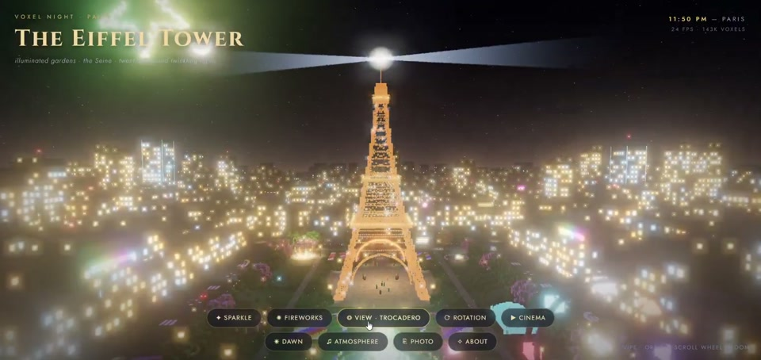</a><br/><a href="https://beatapi.io/prompts/qwen4/voxel-eiffel-966418?utm_source=github&amp;utm_medium=gallery&amp;utm_campaign=awesome-qwen4-videos"><strong>Voxel Eiffel Tower scene</strong></a><br/><sub>Qwen4-Max · 86s</sub><br/><a href="https://beatapi.io/prompts/qwen4/voxel-eiffel-966418?utm_source=github&amp;utm_medium=gallery&amp;utm_campaign=awesome-qwen4-videos">▶ Watch video</a> · <a href="cases/voxel-eiffel-966418.md">Case notes</a><br/><sub>By <a href="https://x.com/nawariokra/status/2122206601217966418">@nawariokra</a></sub></td>
</tr>
<tr>
<td width="33%" valign="top"><a href="https://beatapi.io/prompts/qwen4/voxel-pagoda-garden-844876?utm_source=github&amp;utm_medium=gallery&amp;utm_campaign=awesome-qwen4-videos"></a><br/><a href="https://beatapi.io/prompts/qwen4/voxel-pagoda-garden-844876?utm_source=github&amp;utm_medium=gallery&amp;utm_campaign=awesome-qwen4-videos"><strong>Voxel pagoda garden</strong></a><br/><sub>Qwen4-Max-Preview · 95s</sub><br/><a href="https://beatapi.io/prompts/qwen4/voxel-pagoda-garden-844876?utm_source=github&amp;utm_medium=gallery&amp;utm_campaign=awesome-qwen4-videos">▶ Watch video</a> · <a href="cases/voxel-pagoda-garden-844876.md">Case notes</a><br/><sub>By <a href="https://x.com/Chris_Wozniczek/status/2121680565111844876">@Chris_Wozniczek</a></sub></td>
</tr>
</table>

<a id="animation"></a>

## Animation & explainers

<table>
<tr>
<td width="33%" valign="top"><a href="https://beatapi.io/prompts/qwen4/mechanical-hummingbird-069800?utm_source=github&amp;utm_medium=gallery&amp;utm_campaign=awesome-qwen4-videos"></a><br/><a href="https://beatapi.io/prompts/qwen4/mechanical-hummingbird-069800?utm_source=github&amp;utm_medium=gallery&amp;utm_campaign=awesome-qwen4-videos"><strong>Mechanical hummingbird and flower</strong></a><br/><sub>Qwen4-Max-Preview · 67s</sub><br/><a href="https://beatapi.io/prompts/qwen4/mechanical-hummingbird-069800?utm_source=github&amp;utm_medium=gallery&amp;utm_campaign=awesome-qwen4-videos">▶ Watch video</a> · <a href="cases/mechanical-hummingbird-069800.md">Case notes</a><br/><sub>By <a href="https://x.com/ItsmeAjayKV/status/2120676196921069800">@ItsmeAjayKV</a></sub></td>
<td width="33%" valign="top"><a href="https://beatapi.io/prompts/qwen4/sunbeam-short-film-845187?utm_source=github&amp;utm_medium=gallery&amp;utm_campaign=awesome-qwen4-videos">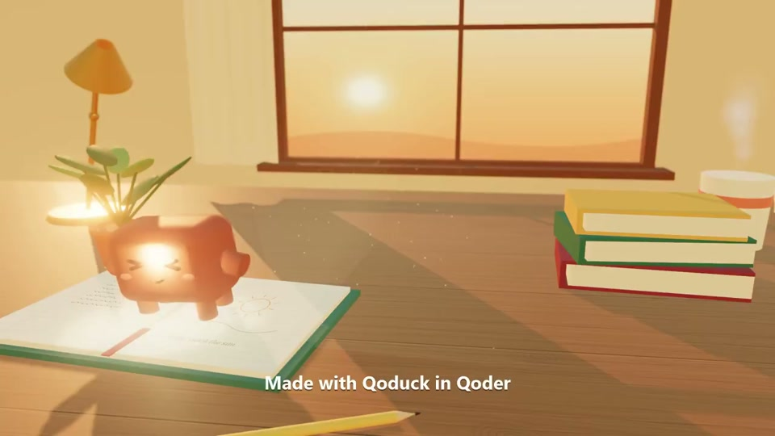</a><br/><a href="https://beatapi.io/prompts/qwen4/sunbeam-short-film-845187?utm_source=github&amp;utm_medium=gallery&amp;utm_campaign=awesome-qwen4-videos"><strong>A mascot chases a sunbeam</strong></a><br/><sub>Qwen4-Max-Preview · 20s</sub><br/><a href="https://beatapi.io/prompts/qwen4/sunbeam-short-film-845187?utm_source=github&amp;utm_medium=gallery&amp;utm_campaign=awesome-qwen4-videos">▶ Watch video</a> · <a href="cases/sunbeam-short-film-845187.md">Case notes</a><br/><sub>By <a href="https://x.com/seeconvm/status/2120547180670845187">@seeconvm</a></sub></td>
<td width="33%" valign="top"><a href="https://beatapi.io/prompts/qwen4/fisherman-oil-portrait-932340?utm_source=github&amp;utm_medium=gallery&amp;utm_campaign=awesome-qwen4-videos"></a><br/><a href="https://beatapi.io/prompts/qwen4/fisherman-oil-portrait-932340?utm_source=github&amp;utm_medium=gallery&amp;utm_campaign=awesome-qwen4-videos"><strong>Painting a fisherman, stroke by stroke</strong></a><br/><sub>Qwen4-Max-Preview · 30s</sub><br/><a href="https://beatapi.io/prompts/qwen4/fisherman-oil-portrait-932340?utm_source=github&amp;utm_medium=gallery&amp;utm_campaign=awesome-qwen4-videos">▶ Watch video</a> · <a href="cases/fisherman-oil-portrait-932340.md">Prompt</a><br/><sub>By <a href="https://x.com/ItsmeAjayKV/status/2122038770421932340">@ItsmeAjayKV</a></sub></td>
</tr>
<tr>
<td width="33%" valign="top"><a href="https://beatapi.io/prompts/qwen4/folding-drone-251469?utm_source=github&amp;utm_medium=gallery&amp;utm_campaign=awesome-qwen4-videos"></a><br/><a href="https://beatapi.io/prompts/qwen4/folding-drone-251469?utm_source=github&amp;utm_medium=gallery&amp;utm_campaign=awesome-qwen4-videos"><strong>Folding drone and exploded view</strong></a><br/><sub>Qwen4-Max-Preview · 20s</sub><br/><a href="https://beatapi.io/prompts/qwen4/folding-drone-251469?utm_source=github&amp;utm_medium=gallery&amp;utm_campaign=awesome-qwen4-videos">▶ Watch video</a> · <a href="cases/folding-drone-251469.md">Case notes</a><br/><sub>By <a href="https://x.com/elvar_official/status/2120537937406251469">@elvar_official</a></sub></td>
<td width="33%" valign="top"><a href="https://beatapi.io/prompts/qwen4/pelican-3d-468988?utm_source=github&amp;utm_medium=gallery&amp;utm_campaign=awesome-qwen4-videos">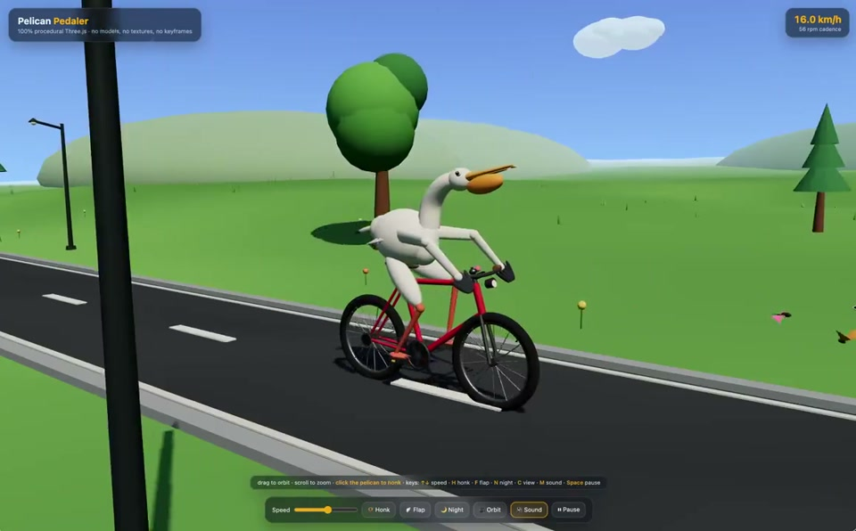</a><br/><a href="https://beatapi.io/prompts/qwen4/pelican-3d-468988?utm_source=github&amp;utm_medium=gallery&amp;utm_campaign=awesome-qwen4-videos"><strong>3D pelican bicycle ride</strong></a><br/><sub>Qwen4-Max · 18s</sub><br/><a href="https://beatapi.io/prompts/qwen4/pelican-3d-468988?utm_source=github&amp;utm_medium=gallery&amp;utm_campaign=awesome-qwen4-videos">▶ Watch video</a> · <a href="cases/pelican-3d-468988.md">Case notes</a><br/><sub>By <a href="https://x.com/Henry_Fan_lh/status/2122256776246468988">@Henry_Fan_lh</a></sub></td>
<td width="33%" valign="top"><a href="https://beatapi.io/prompts/qwen4/internet-machine-223996?utm_source=github&amp;utm_medium=gallery&amp;utm_campaign=awesome-qwen4-videos">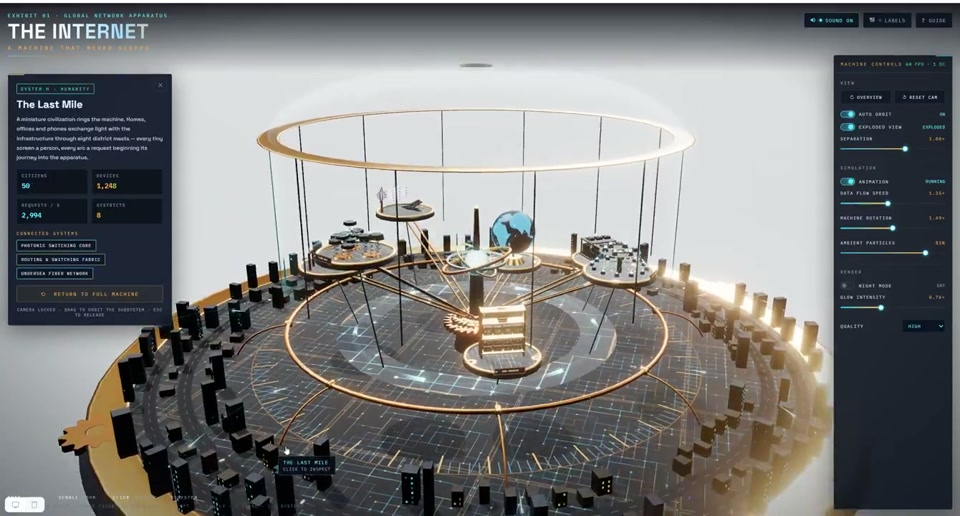</a><br/><a href="https://beatapi.io/prompts/qwen4/internet-machine-223996?utm_source=github&amp;utm_medium=gallery&amp;utm_campaign=awesome-qwen4-videos"><strong>The internet inside one machine</strong></a><br/><sub>Qwen4-Max · 114s</sub><br/><a href="https://beatapi.io/prompts/qwen4/internet-machine-223996?utm_source=github&amp;utm_medium=gallery&amp;utm_campaign=awesome-qwen4-videos">▶ Watch video</a> · <a href="cases/internet-machine-223996.md">Case notes</a><br/><sub>By <a href="https://x.com/Sabbirbyte/status/2122196988838223996">@Sabbirbyte</a></sub></td>
</tr>
<tr>
<td width="33%" valign="top"><a href="https://beatapi.io/prompts/qwen4/svg-pelican-750020?utm_source=github&amp;utm_medium=gallery&amp;utm_campaign=awesome-qwen4-videos"></a><br/><a href="https://beatapi.io/prompts/qwen4/svg-pelican-750020?utm_source=github&amp;utm_medium=gallery&amp;utm_campaign=awesome-qwen4-videos"><strong>SVG pelican bicycle animation</strong></a><br/><sub>Qwen4-Max-Preview · 38s</sub><br/><a href="https://beatapi.io/prompts/qwen4/svg-pelican-750020?utm_source=github&amp;utm_medium=gallery&amp;utm_campaign=awesome-qwen4-videos">▶ Watch video</a> · <a href="cases/svg-pelican-750020.md">Prompt</a><br/><sub>By <a href="https://x.com/Aurora0x3f/status/2122169039061750020">@Aurora0x3f</a></sub></td>
<td width="33%" valign="top"><a href="https://beatapi.io/prompts/qwen4/wukong-airplane-033439?utm_source=github&amp;utm_medium=gallery&amp;utm_campaign=awesome-qwen4-videos"></a><br/><a href="https://beatapi.io/prompts/qwen4/wukong-airplane-033439?utm_source=github&amp;utm_medium=gallery&amp;utm_campaign=awesome-qwen4-videos"><strong>Wukong flies a plane</strong></a><br/><sub>Qwen4-Max-Preview · 86s</sub><br/><a href="https://beatapi.io/prompts/qwen4/wukong-airplane-033439?utm_source=github&amp;utm_medium=gallery&amp;utm_campaign=awesome-qwen4-videos">▶ Watch video</a> · <a href="cases/wukong-airplane-033439.md">Case notes</a><br/><sub>By <a href="https://x.com/leo114119/status/2120371909624033439">@leo114119</a></sub></td>
<td width="33%" valign="top"><a href="https://beatapi.io/prompts/qwen4/breathing-creature-495448?utm_source=github&amp;utm_medium=gallery&amp;utm_campaign=awesome-qwen4-videos">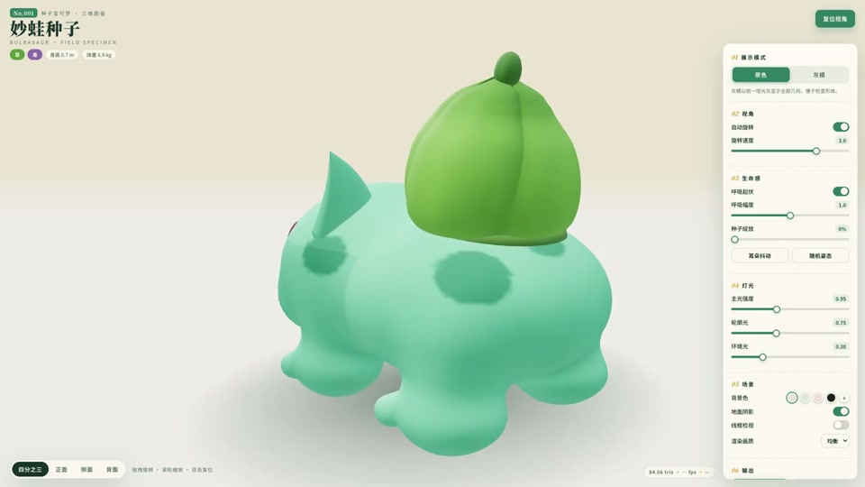</a><br/><a href="https://beatapi.io/prompts/qwen4/breathing-creature-495448?utm_source=github&amp;utm_medium=gallery&amp;utm_campaign=awesome-qwen4-videos"><strong>A breathing, blooming 3D creature</strong></a><br/><sub>Qwen4 (variant unspecified) · 26s</sub><br/><a href="https://beatapi.io/prompts/qwen4/breathing-creature-495448?utm_source=github&amp;utm_medium=gallery&amp;utm_campaign=awesome-qwen4-videos">▶ Watch video</a> · <a href="cases/breathing-creature-495448.md">Case notes</a><br/><sub>By <a href="https://x.com/kayshen_xu/status/2122217886408495448">@kayshen_xu</a></sub></td>
</tr>
<tr>
<td width="33%" valign="top"><a href="https://beatapi.io/prompts/qwen4/spider-web-214830?utm_source=github&amp;utm_medium=gallery&amp;utm_campaign=awesome-qwen4-videos"></a><br/><a href="https://beatapi.io/prompts/qwen4/spider-web-214830?utm_source=github&amp;utm_medium=gallery&amp;utm_campaign=awesome-qwen4-videos"><strong>A spider builds a web</strong></a><br/><sub>Qwen4-Max · 39s</sub><br/><a href="https://beatapi.io/prompts/qwen4/spider-web-214830?utm_source=github&amp;utm_medium=gallery&amp;utm_campaign=awesome-qwen4-videos">▶ Watch video</a> · <a href="cases/spider-web-214830.md">Prompt</a><br/><sub>By <a href="https://x.com/he1000se/status/2122178066273214830">@he1000se</a></sub></td>
</tr>
</table>

<a id="worlds"></a>

## 3D worlds & games

<table>
<tr>
<td width="33%" valign="top"><a href="https://beatapi.io/prompts/qwen4/neon-city-822686?utm_source=github&amp;utm_medium=gallery&amp;utm_campaign=awesome-qwen4-videos">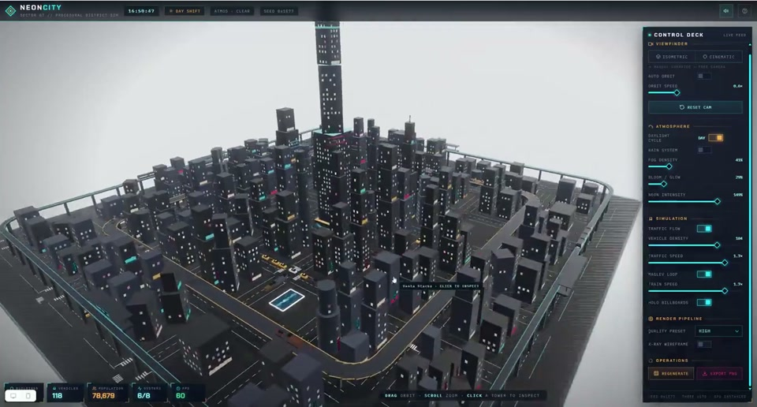</a><br/><a href="https://beatapi.io/prompts/qwen4/neon-city-822686?utm_source=github&amp;utm_medium=gallery&amp;utm_campaign=awesome-qwen4-videos"><strong>Neon city, second attempt</strong></a><br/><sub>Qwen4-Max · 115s</sub><br/><a href="https://beatapi.io/prompts/qwen4/neon-city-822686?utm_source=github&amp;utm_medium=gallery&amp;utm_campaign=awesome-qwen4-videos">▶ Watch video</a> · <a href="cases/neon-city-822686.md">Case notes</a><br/><sub>By <a href="https://x.com/Sabbirbyte/status/2122204889715822686">@Sabbirbyte</a></sub></td>
<td width="33%" valign="top"><a href="https://beatapi.io/prompts/qwen4/floating-moss-garden-563391?utm_source=github&amp;utm_medium=gallery&amp;utm_campaign=awesome-qwen4-videos"></a><br/><a href="https://beatapi.io/prompts/qwen4/floating-moss-garden-563391?utm_source=github&amp;utm_medium=gallery&amp;utm_campaign=awesome-qwen4-videos"><strong>Floating moss garden in mist and rain</strong></a><br/><sub>Qwen4-Max · 37s</sub><br/><a href="https://beatapi.io/prompts/qwen4/floating-moss-garden-563391?utm_source=github&amp;utm_medium=gallery&amp;utm_campaign=awesome-qwen4-videos">▶ Watch video</a> · <a href="cases/floating-moss-garden-563391.md">Case notes</a><br/><sub>By <a href="https://x.com/tanglele0318/status/2122264972889563391">@tanglele0318</a></sub></td>
<td width="33%" valign="top"><a href="https://beatapi.io/prompts/qwen4/blender-tripo-game-449084?utm_source=github&amp;utm_medium=gallery&amp;utm_campaign=awesome-qwen4-videos">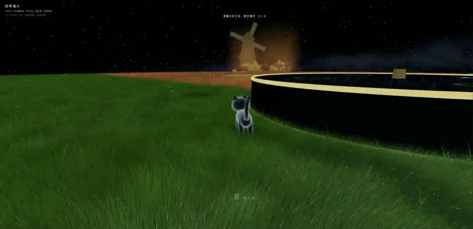</a><br/><a href="https://beatapi.io/prompts/qwen4/blender-tripo-game-449084?utm_source=github&amp;utm_medium=gallery&amp;utm_campaign=awesome-qwen4-videos"><strong>Game demo with Blender and Tripo</strong></a><br/><sub>Qwen4-Max · 11s</sub><br/><a href="https://beatapi.io/prompts/qwen4/blender-tripo-game-449084?utm_source=github&amp;utm_medium=gallery&amp;utm_campaign=awesome-qwen4-videos">▶ Watch video</a> · <a href="cases/blender-tripo-game-449084.md">Case notes</a><br/><sub>By <a href="https://x.com/Pluvio9yte/status/2122250996248449084">@Pluvio9yte</a></sub></td>
</tr>
<tr>
<td width="33%" valign="top"><a href="https://beatapi.io/prompts/qwen4/medieval-world-399531?utm_source=github&amp;utm_medium=gallery&amp;utm_campaign=awesome-qwen4-videos">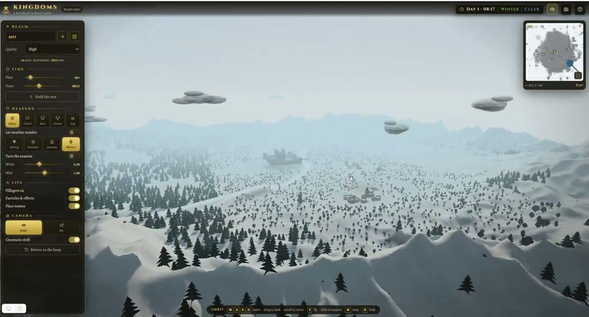</a><br/><a href="https://beatapi.io/prompts/qwen4/medieval-world-399531?utm_source=github&amp;utm_medium=gallery&amp;utm_campaign=awesome-qwen4-videos"><strong>Medieval open-world prototype</strong></a><br/><sub>Qwen4-Max · 139s</sub><br/><a href="https://beatapi.io/prompts/qwen4/medieval-world-399531?utm_source=github&amp;utm_medium=gallery&amp;utm_campaign=awesome-qwen4-videos">▶ Watch video</a> · <a href="cases/medieval-world-399531.md">Case notes</a><br/><sub>By <a href="https://x.com/Sabbirbyte/status/2122212316754399531">@Sabbirbyte</a></sub></td>
<td width="33%" valign="top"><a href="https://beatapi.io/prompts/qwen4/river-falling-leaves-302792?utm_source=github&amp;utm_medium=gallery&amp;utm_campaign=awesome-qwen4-videos"></a><br/><a href="https://beatapi.io/prompts/qwen4/river-falling-leaves-302792?utm_source=github&amp;utm_medium=gallery&amp;utm_campaign=awesome-qwen4-videos"><strong>Custom renderer: river and falling leaves</strong></a><br/><sub>Qwen4-Max-Preview · 111s</sub><br/><a href="https://beatapi.io/prompts/qwen4/river-falling-leaves-302792?utm_source=github&amp;utm_medium=gallery&amp;utm_campaign=awesome-qwen4-videos">▶ Watch video</a> · <a href="cases/river-falling-leaves-302792.md">Case notes</a><br/><sub>By <a href="https://x.com/ItsmeAjayKV/status/2121221346831302792">@ItsmeAjayKV</a></sub></td>
<td width="33%" valign="top"><a href="https://beatapi.io/prompts/qwen4/lantern-water-village-685426?utm_source=github&amp;utm_medium=gallery&amp;utm_campaign=awesome-qwen4-videos">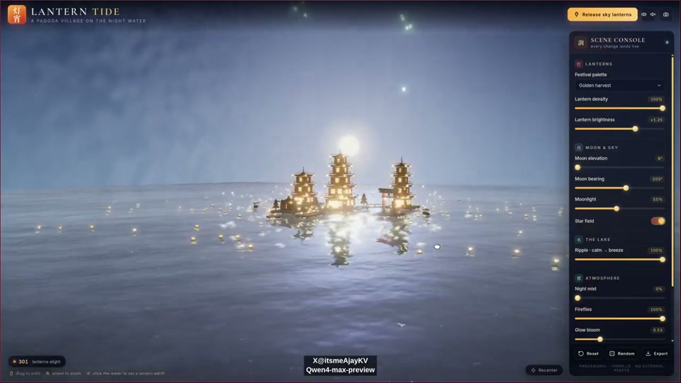</a><br/><a href="https://beatapi.io/prompts/qwen4/lantern-water-village-685426?utm_source=github&amp;utm_medium=gallery&amp;utm_campaign=awesome-qwen4-videos"><strong>Lantern village on the water</strong></a><br/><sub>Qwen4-Max-Preview · 62s</sub><br/><a href="https://beatapi.io/prompts/qwen4/lantern-water-village-685426?utm_source=github&amp;utm_medium=gallery&amp;utm_campaign=awesome-qwen4-videos">▶ Watch video</a> · <a href="cases/lantern-water-village-685426.md">Case notes</a><br/><sub>By <a href="https://x.com/ItsmeAjayKV/status/2121298050878685426">@ItsmeAjayKV</a></sub></td>
</tr>
</table>

<a id="workflows"></a>

## Workflow comparisons

<table>
<tr>
<td width="33%" valign="top"><a href="https://beatapi.io/prompts/qwen4/harness-comparison-659334?utm_source=github&amp;utm_medium=gallery&amp;utm_campaign=awesome-qwen4-videos">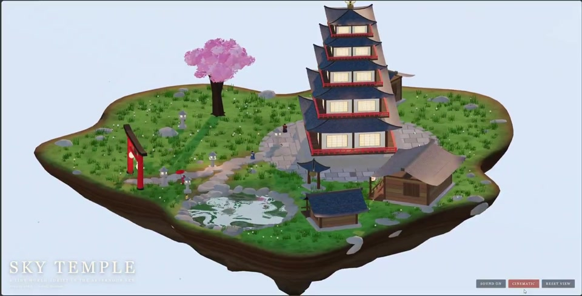</a><br/><a href="https://beatapi.io/prompts/qwen4/harness-comparison-659334?utm_source=github&amp;utm_medium=gallery&amp;utm_campaign=awesome-qwen4-videos"><strong>Qwen Code and DeepSeek Harness comparison</strong></a><br/><sub>Qwen4-Max-Preview · 84s</sub><br/><a href="https://beatapi.io/prompts/qwen4/harness-comparison-659334?utm_source=github&amp;utm_medium=gallery&amp;utm_campaign=awesome-qwen4-videos">▶ Watch video</a> · <a href="cases/harness-comparison-659334.md">Case notes</a><br/><sub>By <a href="https://x.com/EamonMcKiernan5/status/2122090559489659334">@EamonMcKiernan5</a></sub></td>
</tr>
</table>

## About this collection

Max and Max-Preview labels are preserved as reported by each creator. These are recordings of code-generated work, not independent reproductions or a native video-generation API benchmark.

Videos and posters are hosted by BeatAPI. Creator links provide attribution and provenance. Missing prompts are not reconstructed or presented as originals.

[Reddit research and pending candidates](RESEARCH.md) · [Rights and attribution](THIRD_PARTY_NOTICES.md)

## Keep the library growing

For each update: verify the source → archive the original recording and poster → verify prompt text → sync the site case → review six distinct starting points → run catalog and link checks.

```sh
npm run build
npm test
```

Contribute new works, missing prompts or broken-media reports with the original creator URL and exact model version.
