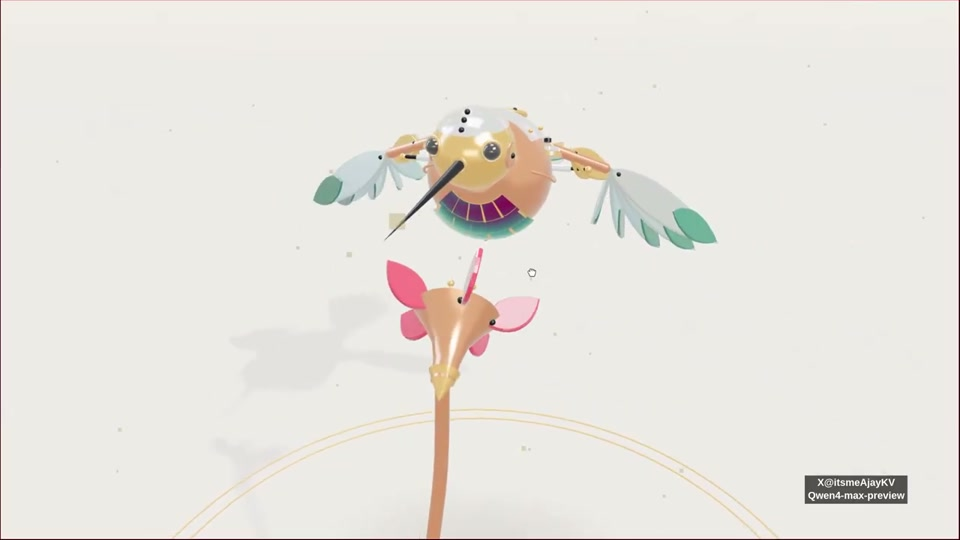
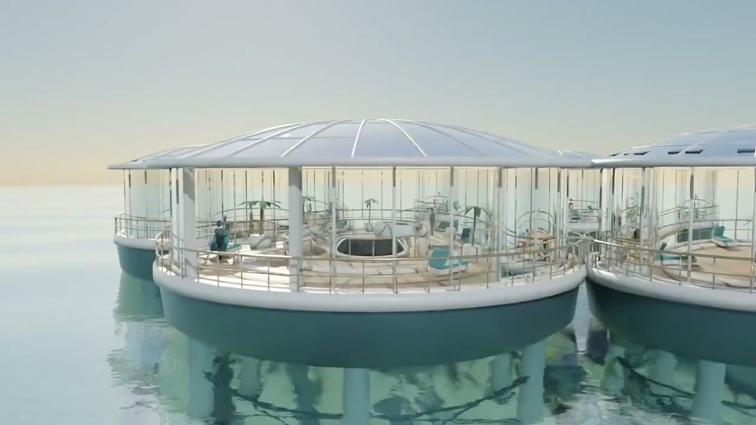
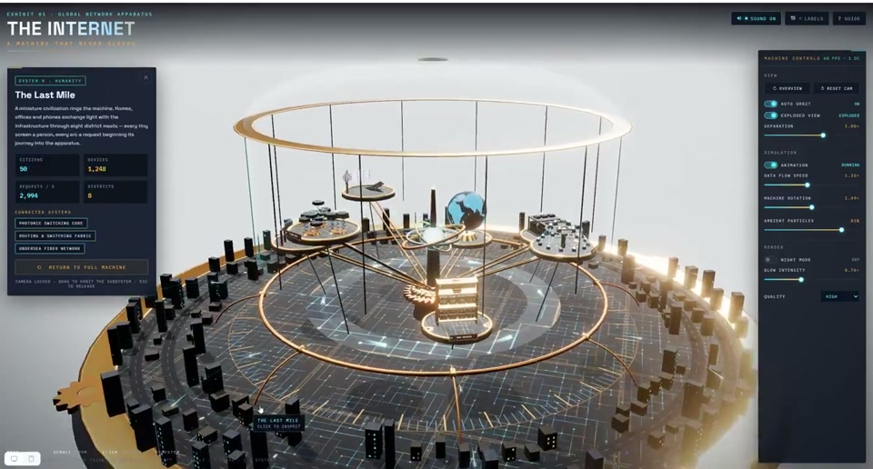

# Awesome Qwen 4 Videos

用千问 4 写代码，做出动画、建筑演示、三维场景和游戏。收录原作者录屏、工作流与已公开提示词，点击作品封面即可进入 BeatAPI 对应案例。

**[在 BeatAPI 观看全部案例 →](https://beatapi.io/zh/qwen4-videos?utm_source=github&utm_medium=gallery&utm_campaign=awesome-qwen4-videos)** · [English](README.md)

**21 个案例 · 22 段视频 · 3 条公开提示词**

最近更新 · 2026-11-16：整理 21 个案例，精选六例，按用途分类。

## 目录

- [精选六例](#highlights)
- [建筑与搭建](#architecture) · 4
- [动画与讲解](#animation) · 10
- [三维场景与游戏](#worlds) · 6
- [工作流对照](#workflows) · 1
- [如何观看与使用](#how-to-use)
- [贡献与来源](#credits)

## 精选六例

先从建筑、机械动画、绘画与三维场景开始。点击封面或标题观看；有公开提示词的案例提供「提示词」入口，其余提供「案例说明」。

<table>
<tr>
<td width="33%" valign="top"> <a href="https://beatapi.io/zh/prompts/qwen4/temple-of-heaven-131506?utm_source=github&amp;utm_medium=gallery&amp;utm_campaign=awesome-qwen4-videos"><strong>天坛祈年殿：线稿到彩色</strong></a> Max-Preview · Three.js · 45s <a href="cases/temple-of-heaven-131506.md">案例说明</a> · <a href="https://x.com/NFT_Chen/status/2120777011065131506">@NFT_Chen</a></td>
<td width="33%" valign="top"> <a href="https://beatapi.io/zh/prompts/qwen4/mechanical-hummingbird-069800?utm_source=github&amp;utm_medium=gallery&amp;utm_campaign=awesome-qwen4-videos"><strong>机械蜂鸟与机械花</strong></a> Max-Preview · 67s <a href="cases/mechanical-hummingbird-069800.md">案例说明</a> · <a href="https://x.com/ItsmeAjayKV/status/2120676196921069800">@ItsmeAjayKV</a></td>
<td width="33%" valign="top"> <a href="https://beatapi.io/zh/prompts/qwen4/fisherman-oil-portrait-932340?utm_source=github&amp;utm_medium=gallery&amp;utm_campaign=awesome-qwen4-videos"><strong>逐笔绘制老渔夫油画</strong></a> Max-Preview · Canvas · 30s <a href="cases/fisherman-oil-portrait-932340.md">提示词</a> · <a href="https://x.com/ItsmeAjayKV/status/2122038770421932340">@ItsmeAjayKV</a></td>
</tr>
<tr>
<td width="33%" valign="top"> <a href="https://beatapi.io/zh/prompts/qwen4/floating-water-house-021434?utm_source=github&amp;utm_medium=gallery&amp;utm_campaign=awesome-qwen4-videos"><strong>Blender 水屋运镜</strong></a> Max · Blender · 40s <a href="cases/floating-water-house-021434.md">案例说明</a> · <a href="https://x.com/NFT_Chen/status/2122265524877021434">@NFT_Chen</a></td>
<td width="33%" valign="top"> <a href="https://beatapi.io/zh/prompts/qwen4/folding-drone-251469?utm_source=github&amp;utm_medium=gallery&amp;utm_campaign=awesome-qwen4-videos"><strong>折叠无人机与爆炸视图</strong></a> Max-Preview · Qoder · 20s <a href="cases/folding-drone-251469.md">案例说明</a> · <a href="https://x.com/elvar_official/status/2120537937406251469">@elvar_official</a></td>
<td width="33%" valign="top"> <a href="https://beatapi.io/zh/prompts/qwen4/floating-moss-garden-563391?utm_source=github&amp;utm_medium=gallery&amp;utm_campaign=awesome-qwen4-videos"><strong>雾雨中的浮石苔藓庭</strong></a> Max · Blender · Qoder · 37s <a href="cases/floating-moss-garden-563391.md">案例说明</a> · <a href="https://x.com/tanglele0318/status/2122264972889563391">@tanglele0318</a></td>
</tr>
</table>

## 建筑与搭建

共 4 个案例；2 个已在上方精选展示，下面为其余 2 个。

本类精选：[天坛祈年殿：线稿到彩色](https://beatapi.io/zh/prompts/qwen4/temple-of-heaven-131506?utm_source=github&utm_medium=gallery&utm_campaign=awesome-qwen4-videos) · [Blender 水屋运镜](https://beatapi.io/zh/prompts/qwen4/floating-water-house-021434?utm_source=github&utm_medium=gallery&utm_campaign=awesome-qwen4-videos)

<table>
<tr>
<td width="33%" valign="top"> <a href="https://beatapi.io/zh/prompts/qwen4/voxel-eiffel-966418?utm_source=github&amp;utm_medium=gallery&amp;utm_campaign=awesome-qwen4-videos"><strong>体素埃菲尔铁塔场景</strong></a> Max · OpenCode · 86s <a href="cases/voxel-eiffel-966418.md">案例说明</a> · <a href="https://x.com/nawariokra/status/2122206601217966418">@nawariokra</a></td>
<td width="33%" valign="top"> <a href="https://beatapi.io/zh/prompts/qwen4/voxel-pagoda-garden-844876?utm_source=github&amp;utm_medium=gallery&amp;utm_campaign=awesome-qwen4-videos"><strong>体素宝塔庭园</strong></a> Max-Preview · Qoder · 95s <a href="cases/voxel-pagoda-garden-844876.md">案例说明</a> · <a href="https://x.com/Chris_Wozniczek/status/2121680565111844876">@Chris_Wozniczek</a></td>
<td width="33%"></td>
</tr>
</table>

## 动画与讲解

共 10 个案例；3 个已在上方精选展示，下面为其余 7 个。

本类精选：[机械蜂鸟与机械花](https://beatapi.io/zh/prompts/qwen4/mechanical-hummingbird-069800?utm_source=github&utm_medium=gallery&utm_campaign=awesome-qwen4-videos) · [逐笔绘制老渔夫油画](https://beatapi.io/zh/prompts/qwen4/fisherman-oil-portrait-932340?utm_source=github&utm_medium=gallery&utm_campaign=awesome-qwen4-videos) · [折叠无人机与爆炸视图](https://beatapi.io/zh/prompts/qwen4/folding-drone-251469?utm_source=github&utm_medium=gallery&utm_campaign=awesome-qwen4-videos)

<table>
<tr>
<td width="33%" valign="top"> <a href="https://beatapi.io/zh/prompts/qwen4/sunbeam-short-film-845187?utm_source=github&amp;utm_medium=gallery&amp;utm_campaign=awesome-qwen4-videos"><strong>追逐阳光的吉祥物短片</strong></a> Max-Preview · Qoder · 20s <a href="cases/sunbeam-short-film-845187.md">案例说明</a> · <a href="https://x.com/seeconvm/status/2120547180670845187">@seeconvm</a></td>
<td width="33%" valign="top"> <a href="https://beatapi.io/zh/prompts/qwen4/pelican-3d-468988?utm_source=github&amp;utm_medium=gallery&amp;utm_campaign=awesome-qwen4-videos"><strong>三维鹈鹕骑行</strong></a> Max · 18s <a href="cases/pelican-3d-468988.md">案例说明</a> · <a href="https://x.com/Henry_Fan_lh/status/2122256776246468988">@Henry_Fan_lh</a></td>
<td width="33%" valign="top"> <a href="https://beatapi.io/zh/prompts/qwen4/internet-machine-223996?utm_source=github&amp;utm_medium=gallery&amp;utm_campaign=awesome-qwen4-videos"><strong>一台机器里的互联网</strong></a> Max · Three.js · 114s <a href="cases/internet-machine-223996.md">案例说明</a> · <a href="https://x.com/Sabbirbyte/status/2122196988838223996">@Sabbirbyte</a></td>
</tr>
<tr>
<td width="33%" valign="top"> <a href="https://beatapi.io/zh/prompts/qwen4/svg-pelican-750020?utm_source=github&amp;utm_medium=gallery&amp;utm_campaign=awesome-qwen4-videos"><strong>SVG 鹈鹕骑车动画</strong></a> Max-Preview · HTML · SVG · 38s <a href="cases/svg-pelican-750020.md">提示词</a> · <a href="https://x.com/Aurora0x3f/status/2122169039061750020">@Aurora0x3f</a></td>
<td width="33%" valign="top"> <a href="https://beatapi.io/zh/prompts/qwen4/wukong-airplane-033439?utm_source=github&amp;utm_medium=gallery&amp;utm_campaign=awesome-qwen4-videos"><strong>孙悟空开飞机</strong></a> Max-Preview · HTML · Qoder · 86s <a href="cases/wukong-airplane-033439.md">案例说明</a> · <a href="https://x.com/leo114119/status/2120371909624033439">@leo114119</a></td>
<td width="33%" valign="top"> <a href="https://beatapi.io/zh/prompts/qwen4/breathing-creature-495448?utm_source=github&amp;utm_medium=gallery&amp;utm_campaign=awesome-qwen4-videos"><strong>会呼吸、开花的三维角色</strong></a> 版本未明确 · Three.js · 26s <a href="cases/breathing-creature-495448.md">案例说明</a> · <a href="https://x.com/kayshen_xu/status/2122217886408495448">@kayshen_xu</a></td>
</tr>
<tr>
<td width="33%" valign="top"> <a href="https://beatapi.io/zh/prompts/qwen4/spider-web-214830?utm_source=github&amp;utm_medium=gallery&amp;utm_campaign=awesome-qwen4-videos"><strong>蜘蛛结网动画</strong></a> Max · OpenCode · 39s <a href="cases/spider-web-214830.md">提示词</a> · <a href="https://x.com/he1000se/status/2122178066273214830">@he1000se</a></td>
<td width="33%"></td>
<td width="33%"></td>
</tr>
</table>

## 三维场景与游戏

共 6 个案例；1 个已在上方精选展示，下面为其余 5 个。

本类精选：[雾雨中的浮石苔藓庭](https://beatapi.io/zh/prompts/qwen4/floating-moss-garden-563391?utm_source=github&utm_medium=gallery&utm_campaign=awesome-qwen4-videos)

<table>
<tr>
<td width="33%" valign="top"> <a href="https://beatapi.io/zh/prompts/qwen4/neon-city-822686?utm_source=github&amp;utm_medium=gallery&amp;utm_campaign=awesome-qwen4-videos"><strong>霓虹城市：第二次尝试</strong></a> Max · 115s <a href="cases/neon-city-822686.md">案例说明</a> · <a href="https://x.com/Sabbirbyte/status/2122204889715822686">@Sabbirbyte</a></td>
<td width="33%" valign="top"> <a href="https://beatapi.io/zh/prompts/qwen4/blender-tripo-game-449084?utm_source=github&amp;utm_medium=gallery&amp;utm_campaign=awesome-qwen4-videos"><strong>Blender 与 Tripo 游戏演示</strong></a> Max · Blender · Tripo · 11s <a href="cases/blender-tripo-game-449084.md">案例说明</a> · <a href="https://x.com/Pluvio9yte/status/2122250996248449084">@Pluvio9yte</a></td>
<td width="33%" valign="top"> <a href="https://beatapi.io/zh/prompts/qwen4/medieval-world-399531?utm_source=github&amp;utm_medium=gallery&amp;utm_campaign=awesome-qwen4-videos"><strong>中世纪开放世界原型</strong></a> Max · Three.js · 139s <a href="cases/medieval-world-399531.md">案例说明</a> · <a href="https://x.com/Sabbirbyte/status/2122212316754399531">@Sabbirbyte</a></td>
</tr>
<tr>
<td width="33%" valign="top"> <a href="https://beatapi.io/zh/prompts/qwen4/river-falling-leaves-302792?utm_source=github&amp;utm_medium=gallery&amp;utm_campaign=awesome-qwen4-videos"><strong>自定义渲染：流水与落叶</strong></a> Max-Preview · HTML · 111s <a href="cases/river-falling-leaves-302792.md">案例说明</a> · <a href="https://x.com/ItsmeAjayKV/status/2121221346831302792">@ItsmeAjayKV</a></td>
<td width="33%" valign="top"> <a href="https://beatapi.io/zh/prompts/qwen4/lantern-water-village-685426?utm_source=github&amp;utm_medium=gallery&amp;utm_campaign=awesome-qwen4-videos"><strong>水上灯笼村落</strong></a> Max-Preview · 62s <a href="cases/lantern-water-village-685426.md">案例说明</a> · <a href="https://x.com/ItsmeAjayKV/status/2121298050878685426">@ItsmeAjayKV</a></td>
<td width="33%"></td>
</tr>
</table>

## 工作流对照

1 个案例。

<table>
<tr>
<td width="33%" valign="top"> <a href="https://beatapi.io/zh/prompts/qwen4/harness-comparison-659334?utm_source=github&amp;utm_medium=gallery&amp;utm_campaign=awesome-qwen4-videos"><strong>Qwen Code 与 DeepSeek Harness 对照</strong></a> Max-Preview · DeepSeek Harness · HTML · 84s <a href="cases/harness-comparison-659334.md">案例说明</a> · <a href="https://x.com/EamonMcKiernan5/status/2122090559489659334">@EamonMcKiernan5</a></td>
<td width="33%"></td>
<td width="33%"></td>
</tr>
</table>

## 如何观看与使用

1. 点击作品封面或标题，在 BeatAPI 查看对应案例的视频与模型信息。
2. 有公开提示词时，可在详情页复制，或打开仓库内的「提示词」。
3. 按作者提供的工具、素材和步骤尝试；未公开完整提示词的案例保留为灵感参考。

*在 BeatAPI 观看原视频，并复制作者公开的提示词。*

## 贡献与来源

欢迎补充作品、原始提示词或反馈失效素材。请附原作者链接和准确模型版本，见[贡献指南](CONTRIBUTING.md)。

保留作者标注的 Qwen4-Max / Max-Preview 等版本；案例为代码生成作品的录屏，未作 BeatAPI 独立复现，也不等同于原生视频生成 API 的测评。视频与封面由 BeatAPI 保存，作者链接用于署名与溯源；未核实的提示词不会补写为原始提示词。

[许可与来源](THIRD_PARTY_NOTICES.md) · [调研与待入库线索](RESEARCH.md)
